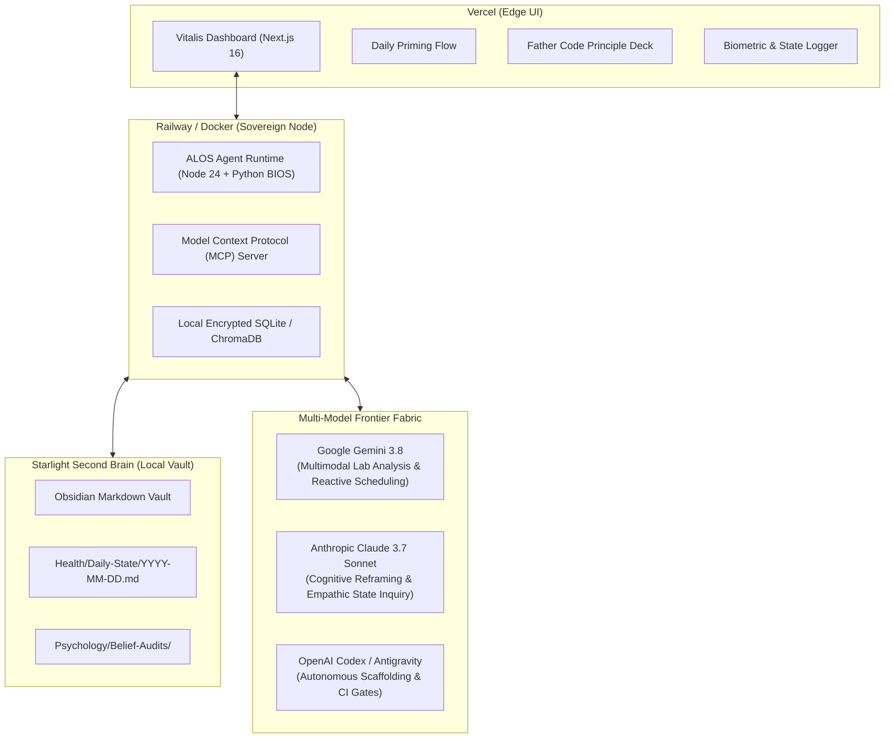

# Vitalis Command Center — 1-Click Deployable Personal Health & State Engine

> *“I do not carry him as pressure. I carry him as a line.”*  
> Built in memory of Witali Riemer (1969–2018).

Vitalis is an open-source, sovereign health, state, and psychology engine designed for builders, creators, and fathers. It couples master craftsman execution standards with the Tony Robbins State Triad, neuro-somatic epigenetics, and subconscious anti-nocebo firewalls.

---

## 1. Deployment Topology



---

## 2. 1-Click Deploy Options

### Option A: Vercel Template (Frontend Dashboard)
Deploy a personal web dashboard on Vercel with zero server maintenance:
* **Framework**: Next.js 16 (App Router), React 19, Tailwind CSS, Radix UI.
* **Features**:
  - Interactive 3-minute Tony Robbins Morning Priming module (audio, paced breathwork cues, gratitude prompts).
  - Father Code interactive decision matrix (10 principles applied to current bottlenecks).
  - State Logger: Track Physiology, Focus, and Meaning scores daily.
  - End-to-end encrypted sync to your private storage.

[](https://vercel.com/new/clone?repository-url=https://github.com/frankxai/agentic-life-os)

---

### Option B: Railway / Self-Hosted Docker (Private Sovereign Engine)
Deploy a dedicated private agent node that keeps all health data local and private:
* **Stack**: Docker, Node.js 24, Python 3.12 BIOS substrate, SQLite.
* **Features**:
  - Exposes an **MCP (Model Context Protocol) Server** so your local Claude Code, Cursor, Codex, or Antigravity agents can query your vitality state:
    ```bash
    # Connect in claude_desktop_config.json
    "vitalis": {
      "command": "npx",
      "args": ["-y", "@frankx-ai/vitalis-mcp-server"]
    }
    ```
  - Autonomous nightly cron auditing biological margin and sleep architecture.
  - Generates zero egress of raw biometrics to third-party ad networks.

[](https://railway.app/new/template)

---

## 3. Starlight Second Brain Synchronization

Vitalis natively writes structured markdown notes to your local Obsidian or Second Brain vault:

### Vault Layout:
```text
second-brain-vault/
├── 01-Vitalis-State/
│   ├── Daily-Priming/
│   │   └── 2026-09-08-priming.md
│   ├── Belief-Audits/
│   │   └── nocebo-interception-log.md
│   └── Biomarkers/
│       └── quarterly-lab-panels.md
└── 02-Father-Code/
    └── craftsman-standards-manifesto.md
```

### Sample Daily Record (`2026-09-08-priming.md`):
```yaml
---
date: 2026-09-08
triad_scores:
  physiology: 9/10
  focus: 10/10
  language_meaning: 9/10
gratitude:
  - "My father's unyielding hands and the foundation he poured."
  - "The gift of clean biological energy today."
massive_action_plan: "Ship the Vitalis Substrate and honor the family line."
biological_margin: optimal
---
```

---

## 4. Multi-Model Synergy Matrix

* **Google (Gemini 3.8 / Antigravity)**: 
  - Parses complex PDF blood panels, hormone assays, and Oura/Whoop trends in 1 prompt.
  - Antigravity's autonomous scheduler checks in at 14:00 and 20:00 for somatic state resets.
* **Anthropic (Claude Code / 3.7 Sonnet)**:
  - The psychological interrogator. Identifies cognitive distortions, catastrophic projections, and white-coat authority panic.
  - Guides nuanced philosophical reflection rooted in Marcus Aurelius, Viktor Frankl, and Tony Robbins.
* **OpenAI / Codex**:
  - Autonomous infrastructure testing, local database migrations, and wearable webhook verification.

---

## 5. Non-Medical Boundary

Vitalis is an educational, psychological, and lifestyle operating system. It does not diagnose, prescribe, or replace licensed oncologists, cardiologists, or mental health professionals. It provides the builder with the internal and biological sovereignty to show up at their highest capability.
